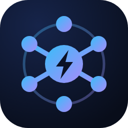

<p align="center"></p>

# FPP Central Hub

A Falcon Player (FPP) plugin that gives you one dashboard for your whole show network.

* **Falcon Players** – discovers every FPP on the network (plus MultiSync-known ones) and shows live cards: now playing + progress, playlist start/stop, volume, temperature, uptime, scheduler, restart FPPD / reboot / shutdown, quick links to FPP pages, and **Open FPP** in a new window.
* **Controllers** (kept separate) – Kulp, Falcon/Baldrick, Experience Lights, Pixel2Things, Hanson Electronics, ESPixelStick (Forkineye), WLED. Status cards with latency history and **Open dashboard** in a new window.
* **Counters & sensors** – the [Christmas Lidar Counter](https://github.com/baelinc/christmas_lidar_counter) (cars tonight, hourly bars, season total, sensor health, ±1 correction buttons) and **BaldrickSignals** crowd boards (devices nearby, 30-minute trend). Add the counter's web password under Edit → Counter login; it is stored on the FPP only and never sent to the browser.
* **Smart plugs** – TP-Link Kasa (KP401, KP303, HS103…), Tasmota and Shelly, all controlled locally. Big on/off cards, per-outlet switches, power draw when available.
* **Per-type network ranges** – e.g. plugs on `192.168.1.x`, FPP/controllers on `192.168.80.x` (Settings → Network ranges). CIDR, `a.b.c.10-50`, `a.b.c.X` or single IPs.
* **Scan button** to search on demand, plus **manual add / remove** (with “test connection” auto-detection) and an ignore list so removed devices stay removed.
* **Extras**: link a plug to a controller/FPP for one-tap **power cycle**; **scenes** (e.g. “Show shutdown”); multi-select **bulk actions**; groups & search; activity log with online/offline events; latency sparklines; export/import backup; light/dark/auto theme and accent colour.
* **Kiosk / phone view** – a standalone page with no FPP menus (`plugin.php?plugin=fpp_Central_Hub&page=kiosk.php&nopage=1`), with optional `&kind=plug|controller|fpp`, `&cols=N`, `&readonly=1`. Wake-lock, fullscreen, clock. Settings → *Kiosk & phone link* builds the URL for you.
* **Auto-recovery watchdog** (background monitor, runs even when no page is open): per device, escalates **1) FPP API restart → 2) SSH command → 3) power-cycle the linked plug**. SSH login is per device or the default (`fpp`/`falcon`). Skipped steps are logged. It only acts while the device is supposed to be powered (inside the plug's **schedule**, or while the plug is on), never cycles a plug that also feeds other devices unless you allow it, and caps power cycles per 24 h. FPP players are also treated as unresponsive when FPPD is stopped or a "playing" playlist stops advancing.
* **Plug schedules** (e.g. road-sign plug and controller plugs at 5:15 pm): optionally switched by the Hub, or "watch only" if FPP/Kasa already switches them.
* **Test patterns** – a Test button on every Falcon Player: pick a model (or custom channel range), pattern and speed. **Lights off** button stops everything and blanks outputs on all FPPs and WLED controllers.
* **Big Buttons & Announcement Assistant** – if a Falcon Player has the *Big Buttons* plugin set up, its card gets a **Buttons** button that opens your same colored buttons (every tab) and presses them on that player. If it has *AA – Announcement Assistant*, the card gets an **Announce** button with one tap per announcement plus **Stop**. The buttons only appear on players where those plugins are installed and configured, and the Hub can only press buttons that exist in the plugin's own configuration. Slider-style (adjustable) Big Buttons stay on the FPP page.
* **Player / remote mode** – each FPP card shows PLAYER, REMOTE or BRIDGE; remote and bridge players hide the playlist controls. The volume control only appears on players you mark as having audio or an FM transmitter.
* All settings live on their own page (Status/Control → *Central Hub Settings*).

## Install (step by step, for beginners)

You need a working Falcon Player (FPP) on your network with internet access. You do **not** need to type any code for Option A.

### Option A – install from the FPP web page (easiest)
1. Open FPP in your browser (for example `http://fpp.local/` or the Pi's IP address).
2. **Turn on the plugin URL box.** Go to **Settings → UI** and set **UI Level** to **Developer** (some versions call the levels Basic / Advanced / Developer). Save. FPP hides the "install from URL" box at the lower levels.
3. Go to **Content Setup → Plugin Manager**.
4. Find the box for the plugin's information URL and paste this exact address:

   `https://raw.githubusercontent.com/baelinc/fpp_Central_Hub/main/pluginInfo.json`

5. Press **Retrieve Plugin Info**, then **Install** when *FPP Central Hub* appears. Wait until FPP says it finished.
6. Restart FPP when asked (or go to **Status/Control → Restart FPPD**).
7. Open **Status/Control → Central Hub**. That is your dashboard. **Central Hub Settings** is right below it.

### Option B – install over SSH (if the Plugin Manager can't find it)
1. Open a terminal (Windows: *PowerShell* or *PuTTY*; Mac/Linux: *Terminal*) and connect: `ssh fpp@fpp.local` (default password `falcon`).
2. Copy and paste these lines one at a time:
   ```
   cd /home/fpp/media/plugins
   git clone https://github.com/baelinc/fpp_Central_Hub
   sudo chown -R fpp:fpp fpp_Central_Hub
   sudo systemctl restart fppd
   ```
3. Open **Status/Control → Central Hub** in FPP.

### First-time setup (about 5 minutes)
1. Open **Central Hub Settings → Network ranges**. The Hub fills in the network it is on. If your devices are on other networks, add them, one type per box, for example plugs on `192.168.1.0/24` and FPP and controllers on `192.168.80.0/24`. Save.
2. Go back to the dashboard and press **Scan**. Cards appear for everything it finds. Anything missed can be added with **Add** (type its IP address and press *Test connection*).
3. On each Falcon Player that has speakers or an FM transmitter, tick **Audio** (Settings → Devices) so its volume control shows.
4. If you use the Christmas Lidar Counter, open its card menu → **Edit → Counter login** and enter the counter page password.
5. For a phone, wall tablet or kiosk: **Settings → Kiosk & phone link**. Scan the QR code with your phone camera, then use *Add to Home Screen*. (Open Settings using the address your phone can reach, such as `fpp.local` or the IP, because the QR code uses the address you are browsing with.)

### Updating
**Central Hub Settings → Updates → Check / Update** (or SSH: `cd /home/fpp/media/plugins/fpp_Central_Hub && git pull`).
If the update says *insufficient permission*, run once over SSH: `sudo chown -R fpp:fpp /home/fpp/media/plugins/fpp_Central_Hub`, then update again.

### If something looks wrong
* **Plugin not found in Plugin Manager** – check UI Level is *Developer* (step 2) or use Option B.
* **No devices after Scan** – the address ranges don't include the devices' network, or FPP can't reach that network.
* **A card says Offline** – the device is off, on a different network than the range you entered, or its IP address changed (give devices fixed IPs in your router).

## Notes & limits
* Discovery is done by the Hub's server (not your browser), so the FPP must be able to route to every configured network.
* Controller detection is keyword-based on the device's web page (editable in Settings → Detection rules). Unrecognised web devices are listed after a scan so you can add them and then tune a rule.
* Kasa devices using the newer authenticated (KLAP/Tapo) protocol are not supported; the legacy local protocol used by KP401 is.
* If an FPP UI password is set, the kiosk URL is protected by it too. “View-only” hides controls and blocks control requests from the kiosk page; it is a convenience, not a security boundary.
* Verified against simulated devices (FPP API, Kasa XOR protocol over TCP/UDP, Tasmota, ESPixelStick/Kulp pages). Shelly and real-hardware behaviour for the other vendors should be confirmed on your network – please open an issue with any device that is missed.

## Notes on auto-recovery
* SSH uses the device's `ssh` client with `SSH_ASKPASS` (OpenSSH 8.4+). Passwords are stored in plain text in FPP's config folder and never sent back to the browser. Most pixel controllers have no SSH – leave step 2 off for those.
* The monitor is started by `scripts/postStart.sh`, and by the dashboard if it is not running. Test it with `php tests/watchdog_test.php` against `tests/mock_devices.py`.

## Layout
`hub_api.php` JSON API (deliberately not named api.php: FPP auto-loads any plugin api.php into its own REST API) · `lib/` discovery + drivers · `dashboard.php`, `kiosk.php`, `settings.php` pages · `assets/` UI · `tests/` mock devices.

## Author
Johnathan Evans

## Android app (side-load)

A native Android app lives in the `android/` folder. It connects to the Hub on your network and shows the same cards (FPP players/remotes, controllers, counters, smart plugs) with playlist start/stop, volume, test patterns, plug switches, "Lights off" for everything, scenes, scanning and the event log.

**Get the APK (no coding needed):**
1. On GitHub open the repo's **Actions** tab, choose **Build Android app**, press **Run workflow**.
2. When it finishes, open the run and download **FPP-Central-Hub-apk** (a zip containing `FPP-Central-Hub.apk`). To get a normal download link instead, push a tag named like `app-v1.0.0`; the APK is attached to a GitHub Release.
3. Copy the APK to your phone, open it, and allow **Install unknown apps** for your browser or file manager when Android asks.
4. Open the app, type the address of the FPP that has this plugin (for example `192.168.1.10`) and tap **Connect**. Your phone must be on the same Wi-Fi (or a VPN into it).

**Build it yourself:** open the `android/` folder in Android Studio and run the app, or run `gradle assembleRelease` there.

The app is signed with a key included in the repo so updates install over older versions. That is fine for side-loading but means it should not be published to Google Play as-is.
